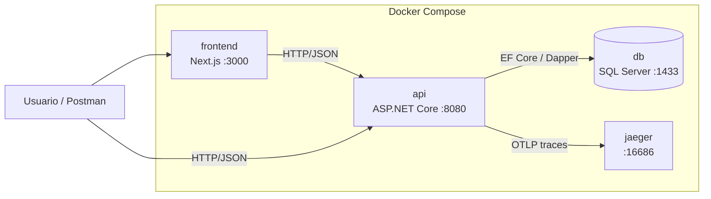
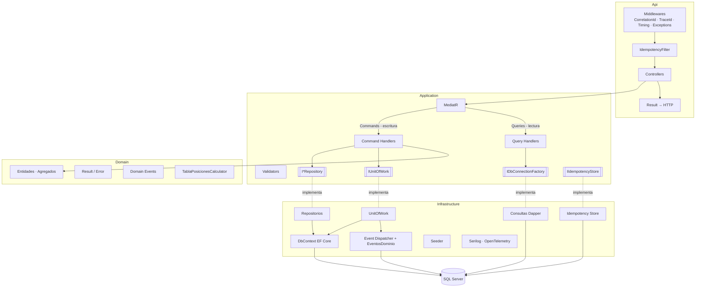
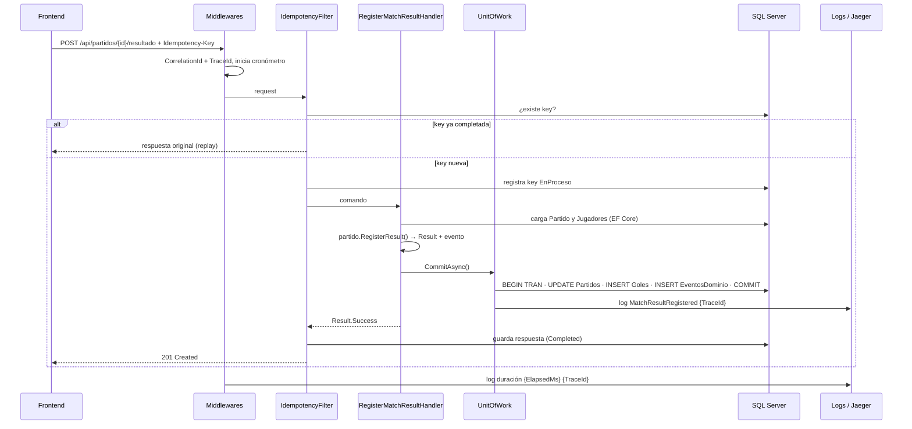

# Ítem 13 – Diagrama de Arquitectura (Obligatorio)

## Requerimiento

Debe representar: capas, CQRS, EF Core (write), Dapper (read), UnitOfWork, idempotency storage, eventos, logs, trace flow, frontend y Docker.

## Entregable

- Archivo fuente editable en `docs/arquitectura/` (Mermaid `.md` renderizable en GitHub y/o draw.io `.drawio`).
- Exportación a imagen (`.png` o `.svg`) incrustada en el README.
- Se recomiendan tres vistas: **contenedores (Docker)**, **componentes por capa (CQRS)** y **secuencia de un request (trace flow)**.

## Vista 1 – Contenedores (Docker)

## Vista 2 – Capas y CQRS

## Vista 3 – Secuencia: registrar resultado (trace flow)

## Checklist de elementos exigidos

| Elemento | Vista |
|---|---|
| Capas | 2 |
| CQRS | 2 |
| EF Core (write) | 2, 3 |
| Dapper (read) | 2 |
| UnitOfWork | 2, 3 |
| Idempotency storage | 2, 3 |
| Eventos | 2, 3 |
| Logs | 2, 3 |
| Trace flow | 3 |
| Frontend | 1, 3 |
| Docker | 1 |

## Implementación real

El diagrama está en [`Arquitectura/README.md`](../Arquitectura/README.md), con las imágenes exportadas en `Arquitectura/img/`. Las vistas de arriba fueron el borrador; la versión final se centra en el sistema del Mundialito:

- **0. Vista general:** frontend con sus secciones, API con sus recursos, SQL Server con sus tablas y Jaeger, dentro de Docker Compose.
- **A. Modelo de datos:** `Torneos`, `TorneoEquipos`, `Equipos`, `Jugadores`, `PosicionesJuego`, `Partidos` y `Goles` con sus relaciones.
- **B. Ciclo de un torneo:** de crear el torneo a cerrarlo, con el endpoint de cada paso.
- **1 a 11:** un diagrama por cada elemento exigido, en el orden del requerimiento, con los nombres reales (19 Commands y 12 Queries, `RegisterPartidoResultCommandHandler`, los cuatro eventos de dominio, las páginas del frontend) y ejemplos de los datos iniciales.

### Ajustes respecto al diseño inicial

| Diseño inicial | Implementado | Motivo |
|---|---|---|
| Carpeta `docs/arquitectura/` | `Arquitectura/` en la raíz | Mismo estilo que `Analisis/` y `Postman/`. |
| Tres vistas grandes | Vista general, modelo de datos, ciclo del torneo y un diagrama por elemento | Cada diagrama se explica en pocos segundos, se corresponde uno a uno con la lista del requerimiento y muestra el contenido del Mundialito, no solo la arquitectura genérica. |
| `IdempotencyFilter` | `IdempotencyMiddleware` | Es un middleware: va después del enrutamiento y antes de los controladores. |
| `RegisterMatchResultHandler` | `RegisterPartidoResultCommandHandler` | Nombre real. |
| Fuente draw.io opcional | Solo Mermaid (fuente) y PNG exportado | GitHub dibuja Mermaid sin herramientas extra y el diagrama se versiona como texto. |

## Criterios de aceptación

- [x] Los 11 elementos exigidos aparecen en el diagrama (un diagrama por elemento en `Arquitectura/README.md`).
- [x] El diagrama está en el repositorio y visible desde el README.
- [x] Coincide con la implementación real (nombres de clases y servicios).
