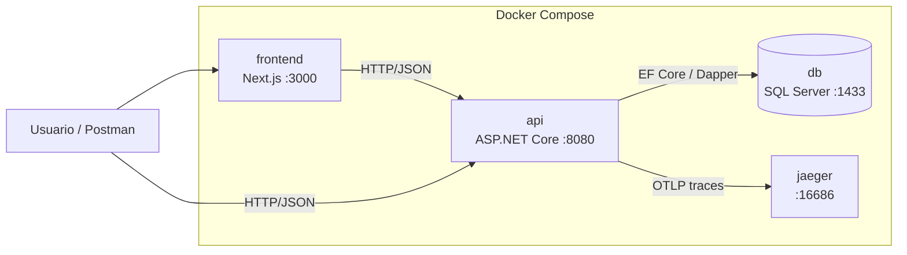
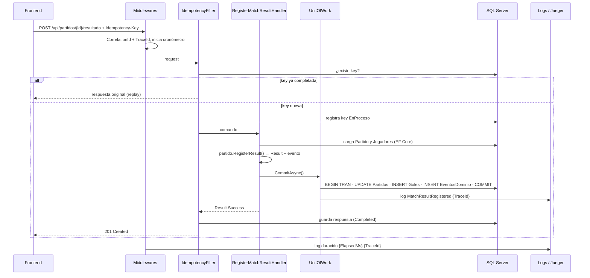

# Ítem 13 – Diagrama de Arquitectura (Obligatorio)

## Requerimiento

Debe representar: capas, CQRS, EF Core (write), Dapper (read), UnitOfWork, idempotency storage, eventos, logs, trace flow, frontend y Docker.

## Entregable

- Archivo fuente editable en `docs/arquitectura/` (Mermaid `.md` renderizable en GitHub y/o draw.io `.drawio`).
- Exportación a imagen (`.png` o `.svg`) incrustada en el README.
- Se recomiendan tres vistas: **contenedores (Docker)**, **componentes por capa (CQRS)** y **secuencia de un request (trace flow)**.

## Vista 1 – Contenedores (Docker)

## Vista 2 – Capas y CQRS

## Vista 3 – Secuencia: registrar resultado (trace flow)

## Checklist de elementos exigidos

| Elemento | Vista |
|---|---|
| Capas | 2 |
| CQRS | 2 |
| EF Core (write) | 2, 3 |
| Dapper (read) | 2 |
| UnitOfWork | 2, 3 |
| Idempotency storage | 2, 3 |
| Eventos | 2, 3 |
| Logs | 2, 3 |
| Trace flow | 3 |
| Frontend | 1, 3 |
| Docker | 1 |

## Criterios de aceptación

- [ ] Los 11 elementos exigidos aparecen en el diagrama.
- [ ] El diagrama está en el repositorio y visible desde el README.
- [ ] Coincide con la implementación real (nombres de clases y servicios).
