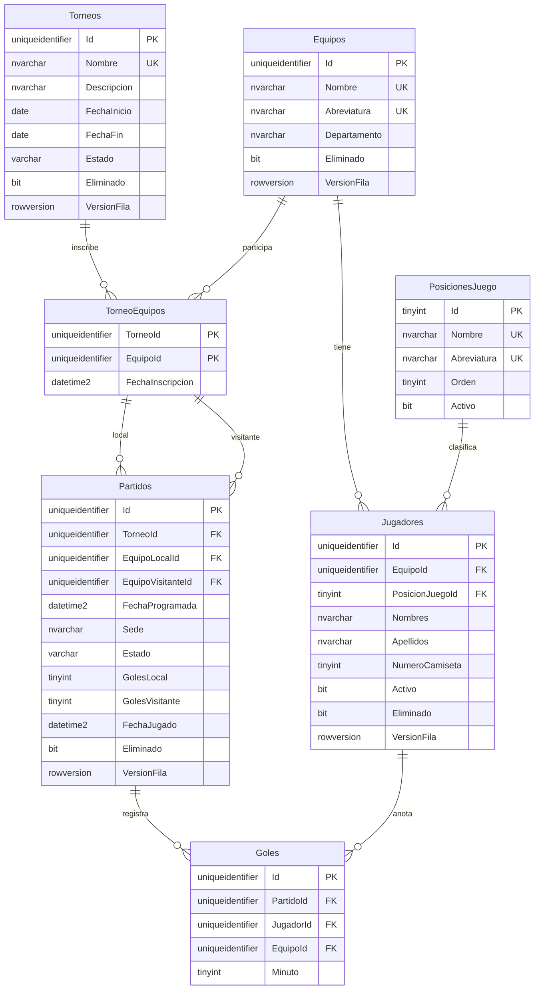

# Análisis de Base de Datos

| Campo | Detalle |
|---|---|
| Motor | SQL Server 2022 (compatible con 2019+), administrado con SSMS |
| Base de datos | `Mundialito` |
| Instancia local | `.\SQLEXPRESS`, autenticación Windows |
| Intercalación | `Modern_Spanish_CI_AS` (sin distinguir mayúsculas, sí acentos) |
| Esquema | `dbo` |
| Idioma de objetos | Español (tablas, columnas y valores de catálogo) |
| Scripts | `Db/001_DDL_CrearBaseDatos.sql`, `Db/002_VIEW_TablaPosicionesGoleadores.sql` |

---

## 1. Por qué SQL Server

El documento técnico no especifica motor. Se elige SQL Server porque:
- Es el estándar en el sector financiero.
- Tiene imagen oficial para Docker (`mcr.microsoft.com/mssql/server:2022-latest`), requisito del ítem 12.
- Soporta todo lo que necesitan las consultas Dapper: `OFFSET/FETCH`, CTE, `COUNT(*) OVER()`, `ROW_NUMBER()`.
- Soporta índices filtrados, necesarios para unicidad combinada con eliminación lógica.
- Tiene `ROWVERSION` nativo para concurrencia optimista con EF Core.

## 2. Idioma de los objetos

El requerimiento no fija idioma para la base de datos, por lo que tablas, columnas y valores de catálogo se nombran **en español**, alineados con el lenguaje del negocio.

Se mantienen sin traducir:
- `Id` y sufijos `...Id` en llaves (convención universal).
- `TraceId` y `CorrelationId`: términos técnicos del propio requerimiento (ítem 7).
- Métodos HTTP (`POST`, `PUT`, …).

Los modelos del código C# (entidades, propiedades y enums) usan los mismos nombres que la base; lo técnico va en inglés (ver `17_Convencion_Nombres.md` y sección 10).

---

## 3. Modelo: torneos, equipos e inscripción

El requerimiento habla de "un torneo de fútbol", pero un Mundialito corporativo se repite cada año. Para que el sistema soporte varias ediciones sin borrar datos se modelan **torneos** (ligas):

- Un **Equipo** existe una sola vez en el sistema (con sus jugadores).
- Un **Torneo** es una edición (ej. *Mundialito Corporativo 2026*).
- Un equipo **se inscribe** en un torneo (`TorneoEquipos`). Puede participar en varios torneos.
- Un **Partido** pertenece a un torneo y solo puede jugarse entre equipos inscritos en él.
- La **tabla de posiciones** y los **goleadores** se calculan **por torneo**.

Formato de competencia: liga de todos contra todos dentro de cada torneo (sin grupos ni eliminación directa), como indica la regla de orden del ítem 8.

## 4. Catálogos y estados

| Concepto | Implementación | Motivo |
|---|---|---|
| Posición del jugador | **Tabla** `PosicionesJuego` | Catálogo extensible: se puede agregar o desactivar una posición sin cambiar el esquema ni el código; el frontend la lista desde la API. |
| Estado del partido | Texto con CHECK (`Programado`, `Jugado`, `Cancelado`) | Cada estado tiene reglas en el dominio (registrar resultado, cancelar). Un estado nuevo exige código nuevo, así que no tiene sentido que sea editable. |
| Estado del torneo | Texto con CHECK (`Planificado`, `EnCurso`, `Finalizado`) | Igual que el anterior: es una máquina de estados del dominio. |

Criterio: **lo que el usuario puede ampliar va en tabla; lo que gobierna reglas de negocio va como estado validado por CHECK.**

Las posiciones se cargan en el propio script DDL (`MERGE`) porque son datos de referencia necesarios para que la estructura funcione, no datos de prueba.

**Terminología:** en el requerimiento "posiciones" significa únicamente la **tabla de posiciones** (clasificación de equipos), que no se almacena: se calcula ("tabla automática"). Para evitar confusión, el catálogo de la posición en la cancha se llama `PosicionesJuego` y la columna del jugador `PosicionJuegoId`. Del mismo modo se usa **Torneo** (término del requerimiento) y no "liga"; cada torneo se juega en formato liga.

---

## 5. Origen de cada tabla en el requerimiento

| Tabla | Requerimiento o decisión que la origina |
|---|---|
| `PosicionesJuego` | Integrantes de equipos: posición de juego (decisión: catálogo en tabla). |
| `Torneos` | "Control de un torneo de fútbol" (decisión: soportar varias ediciones). |
| `Equipos` | Requerimiento general: "Equipos participantes". Ítem 8: CRUD de equipos. Ítem 7: evento al crear equipo. |
| `TorneoEquipos` | "Equipos participantes" de cada torneo. |
| `Jugadores` | Requerimiento general: "Integrante de equipos". Ítem 8: registro por equipo. |
| `Partidos` | Requerimiento general: "Calendario de partidos" y "Resultado de partidos". Ítem 8: filtros por fecha, equipo y estado. |
| `Goles` | Requerimiento general: "Goleadores". Ítem 8: tabla de goleadores. |
| `RegistrosIdempotencia` | Ítem 6: "Persistencia de la key" y "Retornar la misma respuesta original". Ítem 13: "Idempotency storage". |
| `EventosDominio` | Ítem 7: los eventos de dominio deben "ser registrados" y "mantener trazabilidad". |

La **tabla de posiciones no es una tabla física**: se calcula con una consulta (Dapper en la API, vista `vw_TablaPosiciones` en SSMS).

---

## 6. Diagrama entidad-relación

Por legibilidad el diagrama omite las columnas de auditoría (`FechaCreacion`, `FechaModificacion`, `FechaEliminacion`) y las tablas transversales `RegistrosIdempotencia` y `EventosDominio`, que no tienen llaves foráneas.

---

## 7. Diccionario de datos

### 7.1 PosicionesJuego (catálogo)

| Columna | Tipo | Nulo | Default | Descripción |
|---|---|---|---|---|
| Id | tinyint | No | | PK (valor fijo, no autoincremental) |
| Nombre | nvarchar(30) | No | | Único |
| Abreviatura | nvarchar(5) | No | | Única, en mayúsculas |
| Orden | tinyint | No | | Orden de presentación |
| Activo | bit | No | 1 | Una posición inactiva no se asigna a jugadores nuevos |

Datos base: 1 Portero (POR), 2 Defensa (DEF), 3 Mediocampista (MED), 4 Delantero (DEL).

### 7.2 Torneos

| Columna | Tipo | Nulo | Default | Descripción / Regla |
|---|---|---|---|---|
| Id | uniqueidentifier | No | `NEWSEQUENTIALID()` | PK |
| Nombre | nvarchar(100) | No | | Mínimo 3 caracteres. Único entre no eliminados |
| Descripcion | nvarchar(250) | Sí | | |
| FechaInicio | date | No | | |
| FechaFin | date | Sí | | Mayor o igual que `FechaInicio` |
| Estado | varchar(20) | No | `Planificado` | `Planificado`, `EnCurso`, `Finalizado` |
| Eliminado / FechaEliminacion | bit / datetime2(3) | | | Eliminación lógica |
| FechaCreacion / FechaModificacion | datetime2(3) | | | Auditoría UTC |
| VersionFila | rowversion | No | | Concurrencia |

### 7.3 Equipos

| Columna | Tipo | Nulo | Default | Descripción / Regla |
|---|---|---|---|---|
| Id | uniqueidentifier | No | `NEWSEQUENTIALID()` | PK |
| Nombre | nvarchar(100) | No | | Mínimo 3 caracteres. Único entre no eliminados (RN-01) |
| Abreviatura | nvarchar(5) | No | | 2–5 caracteres, en mayúsculas. Única entre no eliminados |
| Departamento | nvarchar(100) | Sí | | Área de la empresa que representa |
| Eliminado / FechaEliminacion | bit / datetime2(3) | | | Eliminación lógica (RN-13) |
| FechaCreacion / FechaModificacion | datetime2(3) | | | Auditoría UTC |
| VersionFila | rowversion | No | | Concurrencia |

### 7.4 TorneoEquipos (inscripción)

| Columna | Tipo | Nulo | Descripción |
|---|---|---|---|
| TorneoId | uniqueidentifier | No | PK compuesta, FK → Torneos |
| EquipoId | uniqueidentifier | No | PK compuesta, FK → Equipos |
| FechaInscripcion | datetime2(3) | No | UTC |

La PK compuesta impide inscribir dos veces el mismo equipo (RN-20). Una inscripción con partidos no puede eliminarse (la FK desde `Partidos` lo impide).

### 7.5 Jugadores

| Columna | Tipo | Nulo | Default | Descripción / Regla |
|---|---|---|---|---|
| Id | uniqueidentifier | No | `NEWSEQUENTIALID()` | PK |
| EquipoId | uniqueidentifier | No | | FK → Equipos. No cambia después de creado (RN-17) |
| PosicionJuegoId | tinyint | No | | FK → Posiciones (RN-22) |
| Nombres | nvarchar(60) | No | | Mínimo 2 caracteres |
| Apellidos | nvarchar(60) | No | | Mínimo 2 caracteres |
| NumeroCamiseta | tinyint | No | | 1–99. Único por equipo entre no eliminados (RN-02) |
| Activo | bit | No | 1 | Jugador habilitado para jugar |
| Eliminado / FechaEliminacion | bit / datetime2(3) | | | Eliminación lógica |
| FechaCreacion / FechaModificacion | datetime2(3) | | | Auditoría UTC |
| VersionFila | rowversion | No | | Concurrencia |

### 7.6 Partidos

| Columna | Tipo | Nulo | Default | Descripción / Regla |
|---|---|---|---|---|
| Id | uniqueidentifier | No | `NEWSEQUENTIALID()` | PK |
| TorneoId | uniqueidentifier | No | | Torneo al que pertenece |
| EquipoLocalId | uniqueidentifier | No | | FK compuesta (`TorneoId`, `EquipoLocalId`) → TorneoEquipos (RN-18) |
| EquipoVisitanteId | uniqueidentifier | No | | FK compuesta (`TorneoId`, `EquipoVisitanteId`) → TorneoEquipos. Distinto del local (RN-04) |
| FechaProgramada | datetime2(0) | No | | Fecha y hora programada, UTC |
| Sede | nvarchar(100) | Sí | | Cancha o sede |
| Estado | varchar(20) | No | `Programado` | `Programado`, `Jugado`, `Cancelado` |
| GolesLocal / GolesVisitante | tinyint | Sí | | Obligatorios solo si `Jugado` |
| FechaJugado | datetime2(3) | Sí | | Momento en que se registró el resultado |
| Eliminado / FechaEliminacion | | | | Un partido `Jugado` no puede eliminarse (RN-12) |
| FechaCreacion / FechaModificacion | datetime2(3) | | | Auditoría UTC |
| VersionFila | rowversion | No | | Evita registrar dos resultados simultáneos |

### 7.7 Goles

| Columna | Tipo | Nulo | Descripción / Regla |
|---|---|---|---|
| Id | uniqueidentifier | No | PK |
| PartidoId | uniqueidentifier | No | FK → Partidos |
| JugadorId | uniqueidentifier | No | Goleador |
| EquipoId | uniqueidentifier | No | FK compuesta (`JugadorId`, `EquipoId`) → Jugadores: el jugador pertenece a ese equipo (RN-08) |
| Minuto | tinyint | No | 1–130 (RN-16) |
| FechaCreacion | datetime2(3) | No | Auditoría UTC |

### 7.8 RegistrosIdempotencia

| Columna | Tipo | Nulo | Descripción |
|---|---|---|---|
| ClaveIdempotencia | nvarchar(100) | No | Valor del header `Idempotency-Key`. PK compuesta |
| RutaSolicitud | nvarchar(300) | No | Ruta del endpoint. PK compuesta |
| MetodoSolicitud | varchar(10) | No | Método HTTP |
| HashSolicitud | char(64) | No | SHA-256 del cuerpo (RN-15) |
| Estado | varchar(20) | No | `EnProceso` o `Completado` |
| CodigoEstadoRespuesta | smallint | Sí | Código HTTP original; obligatorio si `Completado` |
| CuerpoRespuesta | nvarchar(max) | Sí | Cuerpo original para el replay |
| EncabezadosRespuesta | nvarchar(max) | Sí | JSON con `Location`, `Content-Type` |
| FechaCreacion / FechaCompletado | datetime2(3) | | |
| FechaExpiracion | datetime2(3) | No | Vencimiento (24 h) |

### 7.9 EventosDominio

| Columna | Tipo | Nulo | Descripción |
|---|---|---|---|
| Id | uniqueidentifier | No | Id del evento (PK no agrupada) |
| TipoEvento | varchar(150) | No | Ej. `EquipoCreado`, `ResultadoPartidoRegistrado` |
| TipoAgregado | varchar(100) | No | Ej. `Equipo`, `Partido` |
| AgregadoId | uniqueidentifier | No | Id de la entidad que generó el evento |
| DatosEvento | nvarchar(max) | No | JSON válido |
| FechaOcurrencia | datetime2(3) | No | Índice agrupado |
| TraceId | varchar(32) | Sí | TraceId W3C del request |
| CorrelationId | varchar(64) | Sí | CorrelationId del request |
| FechaProcesado | datetime2(3) | Sí | Preparado para patrón Outbox |

---

## 8. Relaciones

| Llave foránea | Desde | Hacia |
|---|---|---|
| FK_TorneoEquipos_Torneos | TorneoEquipos.TorneoId | Torneos.Id |
| FK_TorneoEquipos_Equipos | TorneoEquipos.EquipoId | Equipos.Id |
| FK_Jugadores_Equipos | Jugadores.EquipoId | Equipos.Id |
| FK_Jugadores_PosicionesJuego | Jugadores.PosicionJuegoId | PosicionesJuego.Id |
| FK_Partidos_TorneoEquipoLocal | Partidos.(TorneoId, EquipoLocalId) | TorneoEquipos.(TorneoId, EquipoId) |
| FK_Partidos_TorneoEquipoVisitante | Partidos.(TorneoId, EquipoVisitanteId) | TorneoEquipos.(TorneoId, EquipoId) |
| FK_Goles_Partidos | Goles.PartidoId | Partidos.Id |
| FK_Goles_Equipos | Goles.EquipoId | Equipos.Id |
| FK_Goles_Jugadores_Equipo | Goles.(JugadorId, EquipoId) | Jugadores.(Id, EquipoId) |

Todas sin acción al eliminar: la eliminación es lógica y la base rechaza un borrado físico que dejaría registros huérfanos.

Las FK compuestas de `Partidos` cumplen dos funciones a la vez: garantizan que el torneo y los equipos existen, y que ambos equipos están inscritos en **ese** torneo.

---

## 9. Reglas de negocio garantizadas por la base de datos

La aplicación valida todas las reglas y devuelve el `Result` correspondiente. La base de datos actúa como **segunda línea de defensa** ante errores de código o concurrencia.

| Regla | Mecanismo | Objeto |
|---|---|---|
| RN-01 Nombre de equipo único sin distinguir mayúsculas | Índice único filtrado + intercalación CI | `UX_Equipos_Nombre` |
| Abreviatura única y en mayúsculas | Índice único filtrado + CHECK | `UX_Equipos_Abreviatura`, `CK_Equipos_Abreviatura_Mayus` |
| RN-02 Camiseta única por equipo | Índice único filtrado | `UX_Jugadores_Equipo_NumeroCamiseta` |
| RN-04 Local distinto de visitante | CHECK | `CK_Partidos_EquiposDistintos` |
| RN-05 Un equipo sin dos partidos a la misma hora | Índices únicos filtrados | `UX_Partidos_EquipoLocal_FechaProgramada`, `UX_Partidos_EquipoVisitante_FechaProgramada` |
| Coherencia estado/marcador | CHECK | `CK_Partidos_Resultado` |
| RN-08 Goleador pertenece al equipo | FK compuesta | `FK_Goles_Jugadores_Equipo` |
| RN-12 Partido jugado no se elimina | CHECK | `CK_Partidos_Eliminado` |
| RN-16 Minuto 1–130 | CHECK | `CK_Goles_Minuto` |
| RN-18 Partido solo entre equipos inscritos en el torneo | FK compuestas | `FK_Partidos_TorneoEquipoLocal`, `FK_Partidos_TorneoEquipoVisitante` |
| RN-20 Equipo inscrito una sola vez por torneo | PK compuesta | `PK_TorneoEquipos` |
| RN-22 Posición válida | FK | `FK_Jugadores_PosicionesJuego` |
| Nombre de torneo único, fechas y estado válidos | Índice único filtrado + CHECK | `UX_Torneos_Nombre`, `CK_Torneos_Fechas`, `CK_Torneos_Estado` |
| Idempotencia concurrente | PK compuesta | `PK_RegistrosIdempotencia` |
| Datos de evento válidos | CHECK con `ISJSON` | `CK_EventosDominio_DatosEvento` |

Reglas que valida **solo la aplicación** (requerirían triggers):
- Un equipo que juega como local en un partido y como visitante en otro a la misma hora.
- No programar partidos ni registrar resultados en un torneo `Finalizado` (RN-19).
- Fecha del partido dentro del rango del torneo (RN-21).
- No asignar una posición inactiva a un jugador nuevo.

Cuando un índice único o una FK rechazan una operación, el Unit of Work traduce el error de SQL (2601/2627/547) a `Result.Failure` de tipo Conflict → HTTP 409.

---

## 10. Mapeo entre la base de datos y el código

Las entidades del dominio tienen **los mismos nombres que tablas y columnas** (ver `17_Convencion_Nombres.md`), por lo que el mapeo es casi directo.

| Capa | Cómo se resuelve |
|---|---|
| EF Core (escritura) | `ToTable("Equipos")` por entidad; las columnas se mapean por convención (`Equipo.Nombre` → `Equipos.Nombre`). Se configuran tipos, longitudes, índices y la FK compuesta. |
| Estados | `HasConversion<string>()`: el nombre del enum es el valor de la columna (`EstadoPartido.Jugado` ↔ `'Jugado'`, `EstadoTorneo.EnCurso` ↔ `'EnCurso'`). |
| Posiciones de juego | Entidad de catálogo `PosicionJuego` mapeada a `PosicionesJuego`; el jugador guarda `PosicionJuegoId`. |
| Goles por equipo | `int?` en el dominio ↔ `TINYINT` en la base mediante `HasConversion<byte?>()`. |
| Auditoría y concurrencia | `FechaCreacion`, `FechaModificacion` y `VersionFila` como *shadow properties* de EF Core: existen en la base pero no ensucian el dominio. |
| Dapper (lectura) | Los nombres de columna coinciden con las propiedades de los DTO; no hacen falta alias salvo en columnas calculadas. |
| Filtros de la API | Los parámetros públicos (`sortBy=nombre`, `estado=Jugado`) se validan contra listas blancas antes de construir el SQL. |

---

## 11. Vistas (`Db/002_VIEW_TablaPosicionesGoleadores.sql`)

| Vista | Columnas | Uso |
|---|---|---|
| `vw_TablaPosiciones` | Posicion, TorneoId, Torneo, EquipoId, Equipo, Abreviatura, PJ, G, E, P, GF, GC, DG, Pts | `SELECT * FROM dbo.vw_TablaPosiciones WHERE TorneoId = @Id ORDER BY Posicion` |
| `vw_Goleadores` | Posicion, TorneoId, Torneo, JugadorId, Jugador, NumeroCamiseta, PosicionJuego, EquipoId, Equipo, Goles, PartidosConGol | `SELECT * FROM dbo.vw_Goleadores WHERE TorneoId = @Id ORDER BY Posicion` |

- `vw_TablaPosiciones` parte de `TorneoEquipos`, por lo que incluye equipos inscritos sin partidos jugados (con ceros).
- La posición se calcula con `ROW_NUMBER() OVER (PARTITION BY TorneoId ...)` aplicando el orden oficial: Puntos, Diferencia de gol, Goles a favor, y nombre como desempate final.
- `vw_Goleadores` usa `RANK()`: jugadores empatados en goles comparten posición.
- Las vistas son para revisión en SSMS. La API **no** las usa: calcula lo mismo con Dapper aplicando filtros, orden dinámico y paginación en la propia consulta (ítems 3 y 10).

---

## 12. Índices para las consultas de lectura (Dapper)

| Índice | Consulta que optimiza |
|---|---|
| `IX_Torneos_Estado` | `GET /api/torneos?status=` |
| `IX_Equipos_Departamento` | `GET /api/equipos?department=` |
| `IX_TorneoEquipos_EquipoId` | Torneos en los que participa un equipo |
| `IX_Jugadores_Equipo_Apellidos` | `GET /api/equipos/{id}/jugadores` ordenado por apellido |
| `IX_Jugadores_Apellidos` | `GET /api/jugadores?name=` |
| `IX_Jugadores_PosicionId` | `GET /api/jugadores?positionId=` |
| `IX_Partidos_Torneo_Estado` | Tabla de posiciones por torneo (`Estado = 'Jugado'`) |
| `IX_Partidos_Torneo_FechaProgramada` | Calendario de un torneo |
| `IX_Partidos_FechaProgramada` / `IX_Partidos_Estado` | Filtros por fecha y estado |
| `UX_Partidos_EquipoLocal_*` / `UX_Partidos_EquipoVisitante_*` | `GET /api/partidos?teamId=` |
| `IX_Goles_JugadorId` / `IX_Goles_PartidoId` | Goleadores y detalle de partido |
| `IX_RegistrosIdempotencia_FechaExpiracion` | Limpieza de claves vencidas |
| `IX_EventosDominio_Agregado` / `_TraceId` | Rastrear eventos por entidad o por request |

---

## 13. Decisiones de diseño

| Decisión | Alternativa descartada | Motivo |
|---|---|---|
| Tabla `Torneos` + inscripción | Torneo único implícito | Permite varias ediciones sin borrar datos y aísla tabla y goleadores por torneo. |
| Liga todos contra todos | Grupos y eliminación directa | Es lo que describe el ítem 8 (una tabla ordenada por puntos); grupos agregan alcance sin requerirse. |
| Equipos independientes del torneo | Equipo atado a un torneo | El mismo equipo de la empresa participa año tras año con su historial. |
| Posiciones en tabla | Texto con CHECK | Catálogo extensible y consultable por la API. |
| Estados como texto con CHECK | Tabla de estados | Son máquinas de estado del dominio; un estado nuevo implica código nuevo. |
| Ids `uniqueidentifier` generados por la aplicación | `INT IDENTITY` | El dominio conoce el Id antes de guardar (evento de equipo creado, header `Location`). No expone cantidades. |
| GUID secuencial | `NEWID()` aleatorio | Evita fragmentar el índice agrupado. |
| Eliminación lógica | Borrado físico | DELETE idempotente y conservación del historial. |
| Tabla de posiciones calculada | Tabla física actualizada | Siempre consistente, sin lógica de recálculo. |
| `ROWVERSION` | Sin control de concurrencia | Evita registrar dos resultados del mismo partido a la vez (→ 409). |
| Fechas UTC con `datetime2` | `datetime` / hora local | Precisión y sin ambigüedad de zona horaria. |

---

## 14. Relación entre los scripts y EF Core

- Los scripts de `Db/` son el **diseño de referencia** y permiten trabajar desde SSMS desde el primer día.
- Las configuraciones de EF Core replicarán exactamente este esquema.
- En Docker, la API crea la base con las migraciones de EF Core; las vistas y los datos de catálogo se incluyen en la migración (`migrationBuilder.Sql` / `HasData` para `PosicionesJuego`). El script de la migración se exportará a `Db/` y se comparará con estos scripts.
- En desarrollo local se usa uno de los dos caminos, no ambos sobre la misma base.

---

## 15. Validación realizada

Ambos scripts se ejecutaron dos veces seguidas en una base temporal (re-ejecutables, sin errores). Con datos de dos torneos se probaron 19 casos que deben ser rechazados:

| Caso | Rechazado por |
|---|---|
| Partido con un equipo no inscrito en el torneo | `FK_Partidos_TorneoEquipoLocal` |
| Inscripción duplicada | `PK_TorneoEquipos` |
| Quitar una inscripción con partidos | FK desde `Partidos` |
| Posición inexistente | `FK_Jugadores_PosicionesJuego` |
| Torneo con fecha fin anterior al inicio | `CK_Torneos_Fechas` |
| Torneo con estado no válido | `CK_Torneos_Estado` |
| Nombre de torneo duplicado (otras mayúsculas) | `UX_Torneos_Nombre` |
| Nombre de equipo duplicado (otras mayúsculas) | `UX_Equipos_Nombre` |
| Abreviatura en minúsculas | `CK_Equipos_Abreviatura_Mayus` |
| Camiseta repetida en el mismo equipo | `UX_Jugadores_Equipo_NumeroCamiseta` |
| Partido con el mismo equipo como local y visitante | `CK_Partidos_EquiposDistintos` |
| Equipo con dos partidos a la misma hora | `UX_Partidos_*_FechaProgramada` |
| Partido `Jugado` sin marcador | `CK_Partidos_Resultado` |
| Eliminar un partido jugado | `CK_Partidos_Eliminado` |
| Gol acreditado a otro equipo | `FK_Goles_Jugadores_Equipo` |
| Minuto 0 | `CK_Goles_Minuto` |
| Clave de idempotencia duplicada | `PK_RegistrosIdempotencia` |
| Datos de evento que no son JSON | `CK_EventosDominio_DatosEvento` |
| Borrado físico de un equipo con jugadores | `FK_Jugadores_Equipos` |

**Vistas:** con los datos del seed, `vw_TablaPosiciones` devolvió exactamente la tabla esperada del ítem 9 (Operaciones City 4 pts, Tecnología FC 3, Recursos Humanos Athletic 1, Finanzas United 0). La derrota 0–5 de Tecnología FC en el torneo 2025 no afectó su tabla 2026, lo que confirma el aislamiento por torneo. `vw_Goleadores` ordenó correctamente y compartió posición entre empatados.

**Lección aprendida:** restar columnas `TINYINT` con resultado negativo desborda; las consultas convierten los goles a `INT` antes de calcular.

---

## 16. Próximos scripts

| Script | Contenido |
|---|---|
| `003_DML_SeedInicial.sql` | Datos del ítem 9: 1 torneo, 4 equipos inscritos, 20 jugadores, 6 partidos, 3 jugados |
| `010_QRY_TablaPosiciones.sql` | Consulta paginada de tabla de posiciones usada por Dapper |
| `011_QRY_Goleadores.sql` | Consulta paginada de goleadores |
| `0NN_MIG_InitialCreate.sql` | Script exportado de la migración inicial de EF Core |
