# Diagrama de arquitectura

Arquitectura del Mundialito Corporativo: el sistema que gestiona torneos de fútbol entre departamentos, con sus equipos, integrantes, calendario de partidos, resultados, tabla de posiciones y goleadores.

Primero se presenta el sistema (vista general, modelo de datos y ciclo de un torneo) y después un diagrama por cada elemento de la arquitectura, siempre con los nombres reales de las clases, tablas y endpoints y con ejemplos de los datos iniciales. GitHub dibuja los diagramas Mermaid directamente; cada uno también está exportado como imagen en [`img/`](img/).

| # | Diagrama | Imagen |
|---|---|---|
| 0 | [Vista general](#0-vista-general) | [PNG](img/00_vista_general.png) |
| A | [Modelo de datos del Mundialito](#a-modelo-de-datos-del-mundialito) | [PNG](img/00_modelo_datos.png) |
| B | [Ciclo de un torneo](#b-ciclo-de-un-torneo) | — |
| 1 | [Capas](#1-capas) | [PNG](img/01_capas.png) |
| 2 | [CQRS](#2-cqrs) | [PNG](img/02_cqrs.png) |
| 3 | [EF Core (write)](#3-ef-core-write) | [PNG](img/03_ef_core_write.png) |
| 4 | [Dapper (read)](#4-dapper-read) | [PNG](img/04_dapper_read.png) |
| 5 | [UnitOfWork](#5-unitofwork) | [PNG](img/05_unit_of_work.png) |
| 6 | [Idempotency storage](#6-idempotency-storage) | [PNG](img/06_idempotency_storage.png) |
| 7 | [Eventos](#7-eventos) | [PNG](img/07_eventos.png) |
| 8 | [Logs](#8-logs) | [PNG](img/08_logs.png) |
| 9 | [Trace flow](#9-trace-flow) | [PNG](img/09_trace_flow.png) |
| 10 | [Frontend](#10-frontend) | [PNG](img/10_frontend.png) |
| 11 | [Docker](#11-docker) | [PNG](img/11_docker.png) |

---

## 0. Vista general

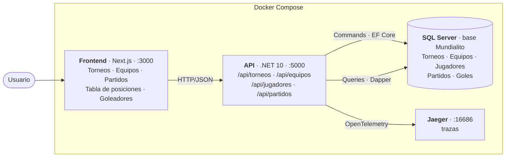

El usuario gestiona el torneo desde el frontend; el frontend llama a la API REST; la API guarda torneos, equipos, jugadores, partidos y goles en SQL Server (escribe con EF Core y lee con Dapper) y envía sus trazas a Jaeger. Todo levanta con `docker-compose up`.

---

## A. Modelo de datos del Mundialito

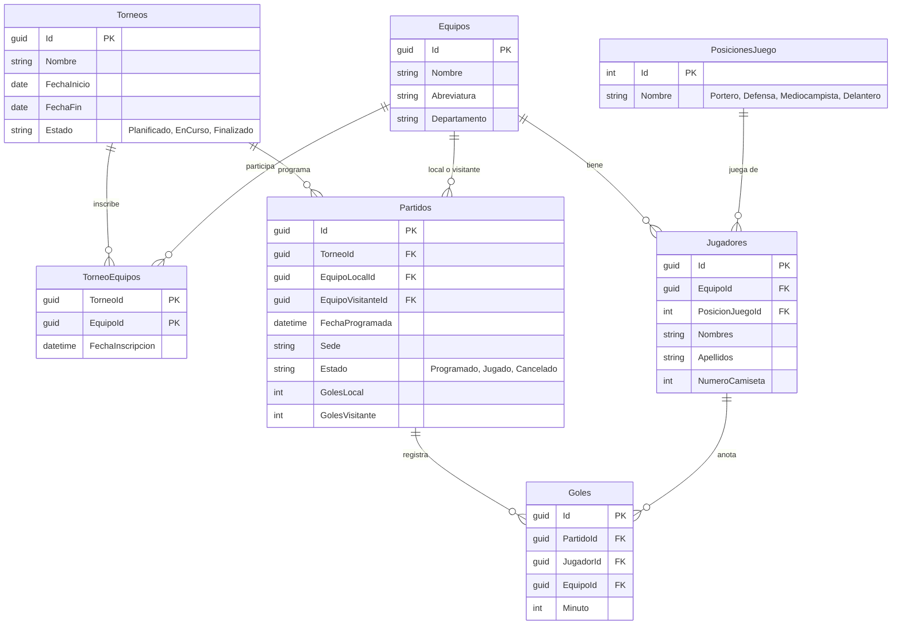

Un torneo inscribe equipos (`TorneoEquipos`), cada equipo tiene sus integrantes con una posición de juego, el torneo programa partidos entre dos equipos inscritos y cada partido jugado registra sus goles con el jugador y el minuto. La tabla de posiciones y los goleadores no se guardan: se calculan desde `Partidos` y `Goles`. Además existen `EventosDominio` y `RegistrosIdempotencia` (diagramas 6 y 7).

---

## B. Ciclo de un torneo

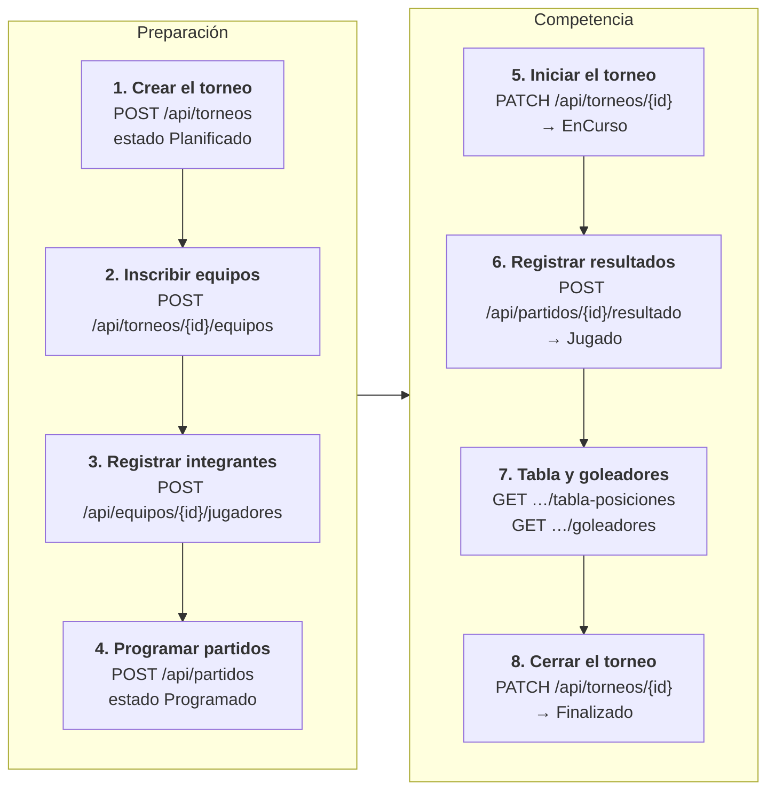

Este es el recorrido funcional completo de un torneo. Los estados solo avanzan (un torneo `Finalizado` no vuelve a `EnCurso`) y un torneo finalizado ya no acepta inscripciones, partidos ni resultados. Los datos iniciales dejan el sistema en el paso 6: *Mundialito Corporativo 2026* en curso, 4 equipos, 20 jugadores y 6 partidos, 3 ya jugados.

---

## 1. Capas

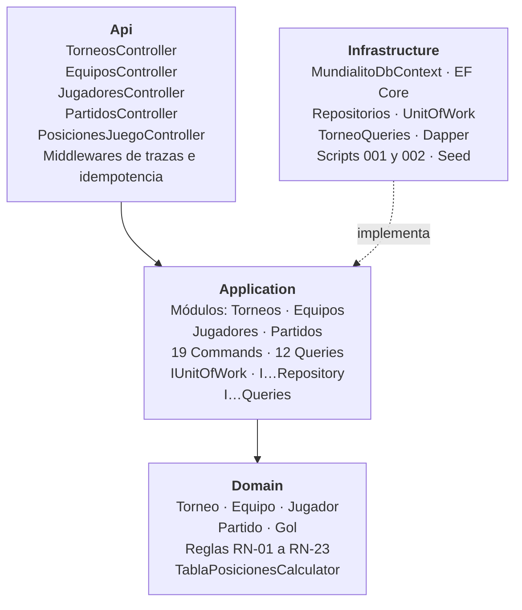

Las reglas del Mundialito (por ejemplo, que un goleador debe pertenecer a su equipo o que un equipo no juega dos partidos a la misma hora) viven en Domain, sin depender de nada. Application organiza los casos de uso por módulo; Infrastructure resuelve la base de datos; Api solo recibe HTTP y orquesta. Las pruebas de arquitectura verifican estas dependencias.

---

## 2. CQRS

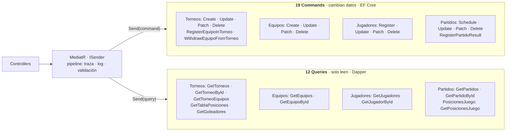

Todo lo que cambia el torneo (inscribir un equipo, programar un partido, registrar un resultado) es un Command; todo lo que se consulta (tabla, goleadores, calendario) es una Query. MediatR envía cada uno a su handler a través del pipeline: `ObservabilityBehavior` abre el span y registra la duración, y `ValidationBehavior` valida la entrada antes del handler.

---

## 3. EF Core (write)

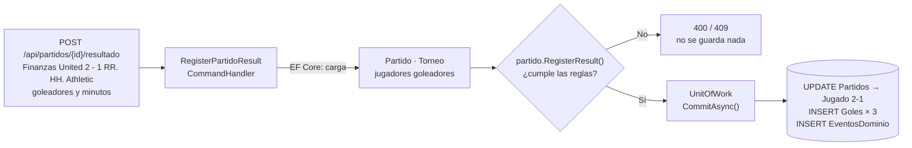

Para registrar el resultado de un partido pendiente se cargan el partido, su torneo y los goleadores con EF Core. El dominio valida las reglas: el partido debe estar `Programado`, el torneo no puede estar finalizado, los goles deben coincidir con el marcador, cada goleador debe ser de su equipo y el minuto debe estar entre 1 y 130. Si algo falla responde 400 o 409 sin guardar; si todo es correcto, el Unit of Work guarda el partido, los goles y el evento.

---

## 4. Dapper (read)

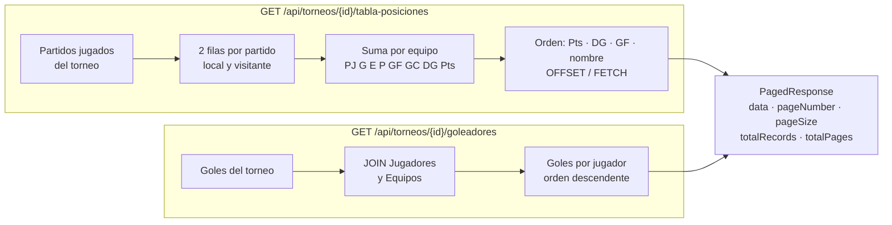

La tabla de posiciones y los goleadores se calculan en SQL con Dapper cada vez que se consultan. Con los datos iniciales la tabla queda: Operaciones City 4 pts (DG +3), Tecnología FC 3 (−2), Recursos Humanos Athletic 1 (0) y Finanzas United 0 (−1). La paginación y el orden se hacen en la base y `sortBy` solo acepta columnas de una lista blanca.

---

## 5. UnitOfWork

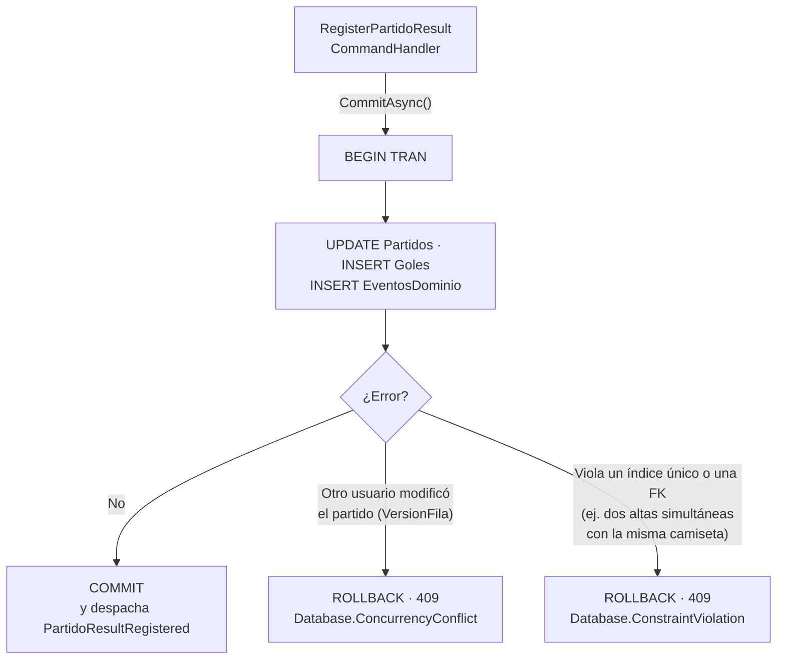

El resultado, los goles y el evento se guardan juntos: o queda todo o no queda nada, así nunca hay un partido `Jugado` sin sus goles. Si dos personas registran a la vez sobre el mismo partido, la segunda recibe 409 en lugar de sobrescribir.

---

## 6. Idempotency storage

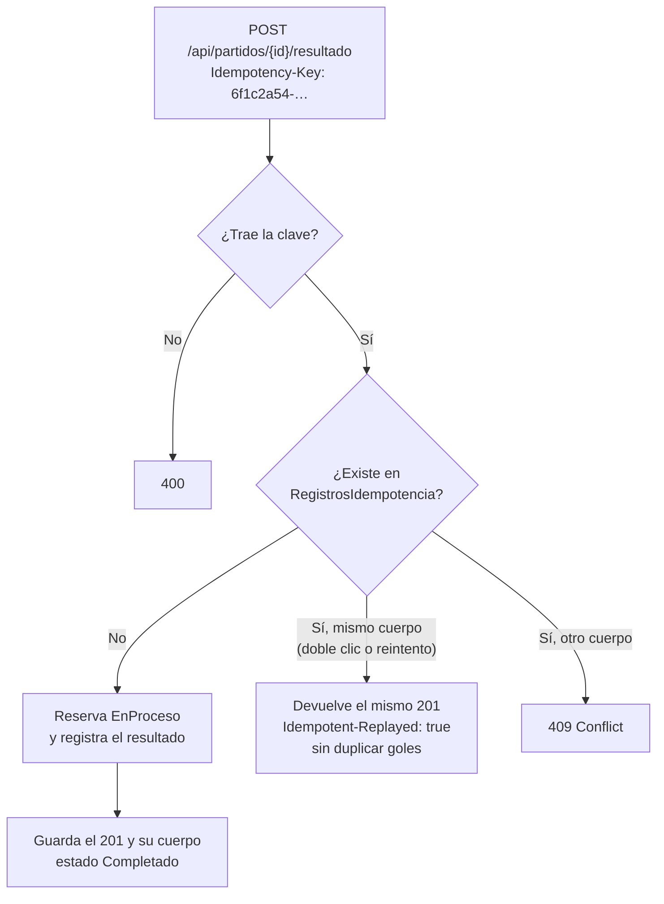

Si el usuario hace doble clic en «Registrar resultado» o la red reintenta la petición, la segunda llamada recibe la misma respuesta y los goles no se registran dos veces. Lo mismo protege la creación de torneos, equipos, jugadores, partidos e inscripciones: todo POST lleva su clave.

---

## 7. Eventos

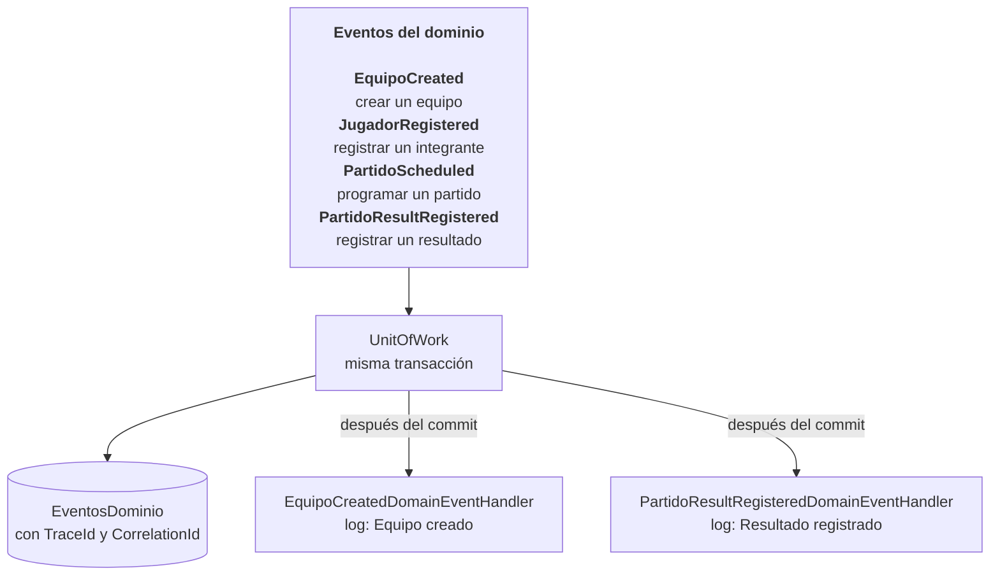

El dominio emite cuatro eventos y todos quedan guardados en `EventosDominio`, con el request que los originó. Los dos que pide el requerimiento, equipo creado y resultado registrado, tienen además un handler que escribe un log; los otros dos quedan disponibles para futuras reacciones, como notificar a los equipos.

---

## 8. Logs

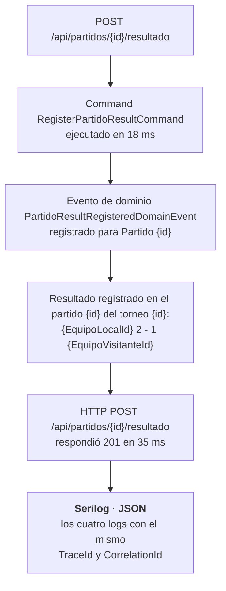

Registrar un resultado deja cuatro logs estructurados, uno por cada etapa. Como todos comparten el TraceId, se puede filtrar y ver la historia completa de ese registro. Los 4xx y las peticiones de más de 500 ms se registran como Warning y los 5xx como Error.

---

## 9. Trace flow

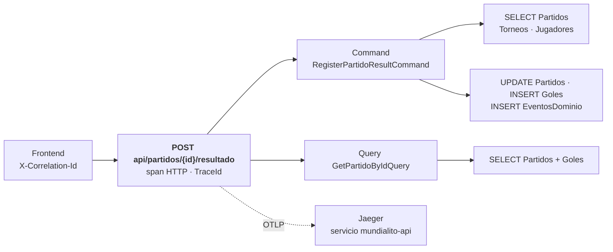

Así se ve en Jaeger el registro de un resultado: el request HTTP contiene el span del Command, que contiene las consultas SQL de lectura y escritura, y al final la Query que arma la respuesta 201. El mismo TraceId aparece en los logs, en `EventosDominio` y en cualquier error (ProblemDetails).

---

## 10. Frontend

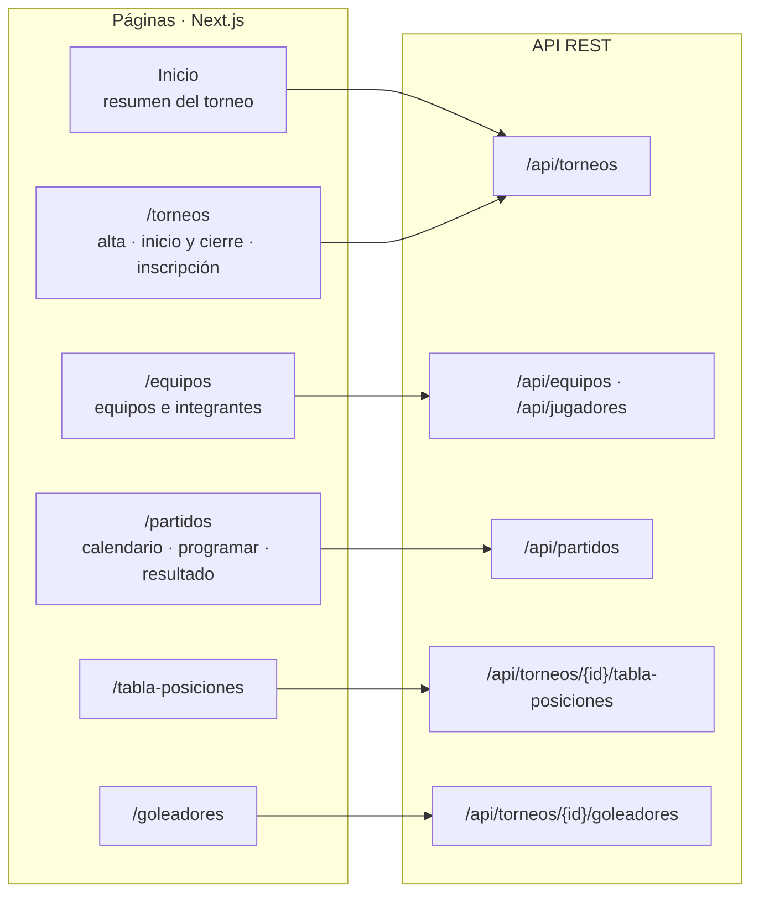

Cada sección del frontend corresponde a un recurso de la API. Las páginas leen con Server Components y los formularios (crear, editar, eliminar, registrar resultado) escriben con Server Actions; en ambos casos es el servidor de Next.js el que llama a la API, nunca el navegador.

---

## 11. Docker

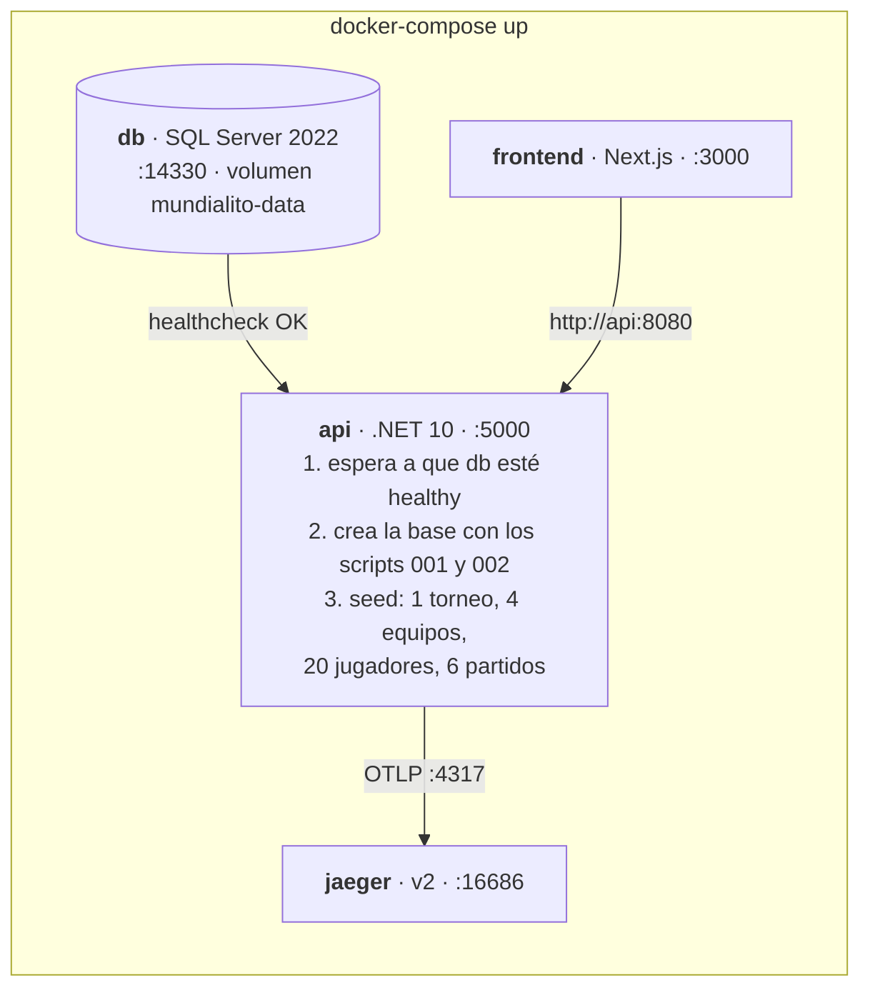

Con un solo comando quedan los cuatro contenedores y el Mundialito listo para usar: la API espera a la base, crea el esquema, carga el torneo de ejemplo y el frontend ya muestra la tabla de posiciones.

---

## Cómo regenerar las imágenes

El código Mermaid de este archivo es la fuente. Para volver a exportar un diagrama, copiar su bloque a un archivo `.mmd` y ejecutar:

```bash
npx @mermaid-js/mermaid-cli -i diagrama.mmd -o img/diagrama.png -b white -s 2
```
