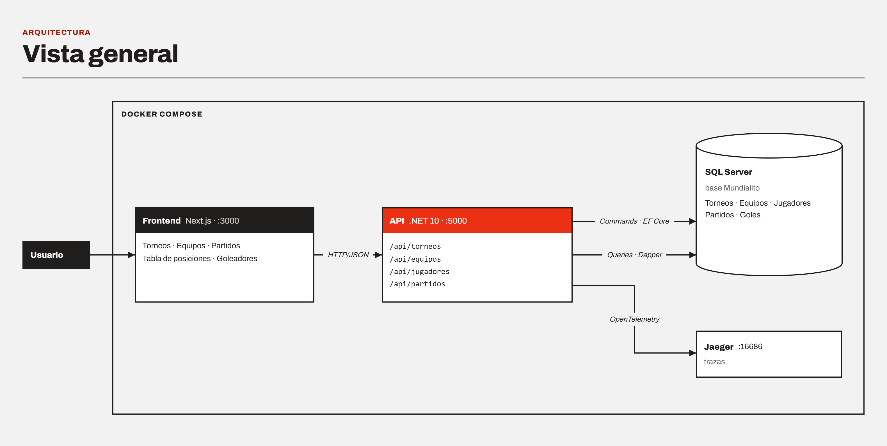

# Mundialito Corporativo

Sistema de gestión de un torneo de fútbol corporativo: equipos, integrantes, calendario de partidos, resultados, tabla de posiciones y goleadores.

API en **.NET 10** con **Clean Architecture**, **CQRS** (EF Core para escritura, Dapper para lectura), **Unit of Work**, **Result Pattern**, REST idempotente y observabilidad; base de datos **SQL Server 2022**.

> **Estado:** en desarrollo. Ver [Estado por ítem](#estado-por-ítem).

---

## Estructura

```
MundialitoCorporativo/
├── MundialitoCorp_Back/       Backend .NET 10 (solución MundialitoCorporativo.slnx y Directory.Build.props)
│   ├── src/
│   │   ├── MundialitoCorporativo.Domain          Modelos, reglas de negocio, Result Pattern, eventos de dominio
│   │   ├── MundialitoCorporativo.Application     CQRS: despachador, Commands, Queries, validaciones y contratos
│   │   ├── MundialitoCorporativo.Infrastructure  EF Core, repositorios, Unit of Work, consultas Dapper y scripts SQL del esquema
│   │   └── MundialitoCorporativo.Api             Controladores REST, idempotencia, observabilidad, errores HTTP y composition root
│   └── tests/
│       ├── MundialitoCorporativo.UnitTests         Arquitectura, dominio, CQRS, Unit of Work, idempotencia, mapeo HTTP y observabilidad
│       └── MundialitoCorporativo.IntegrationTests  CQRS, idempotencia, trazabilidad y API por HTTP contra SQL Server
├── MundialitoCorp_Front/      Frontend Next.js (torneos, equipos e integrantes, partidos, resultados, tabla y goleadores)
├── Postman/                   Colección y entorno de Postman
├── Analisis/                  Análisis del requerimiento, un documento por ítem
├── Arquitectura/              Diagrama de arquitectura (Mermaid e imágenes)
├── docker-compose.yml         Base de datos, API, frontend y Jaeger
└── .env.example               Variables opcionales de docker-compose
```

Cada proyecto tiene su `Dockerfile` y `.dockerignore` (`MundialitoCorp_Back/` y `MundialitoCorp_Front/`).

Reglas de dependencia (verificadas con pruebas de arquitectura): Domain no depende de ninguna capa; Application depende solo de Domain; Infrastructure implementa los contratos de Application; Api solo orquesta.

## Arquitectura



El diagrama completo está en [Arquitectura/](Arquitectura/README.md): vista general, modelo de datos del Mundialito (torneos, equipos, jugadores, partidos y goles), ciclo de un torneo con sus endpoints y un diagrama por cada elemento de la arquitectura (capas, CQRS, EF Core, Dapper, UnitOfWork, idempotency storage, eventos, logs, trace flow, frontend y Docker), con ejemplos de los datos iniciales.

## Ejecutar con Docker

Requisito: Docker Desktop (o Docker Engine con Compose). Desde la raíz del repositorio:

```bash
docker-compose up --build
```

Levanta SQL Server, la API, el frontend y Jaeger. La API espera a que la base esté lista, crea el esquema y carga los datos iniciales; no hay pasos manuales.

| Servicio | URL |
|---|---|
| Frontend | http://localhost:3000 |
| API | http://localhost:5000/api |
| Scalar | http://localhost:5000/scalar |
| Jaeger (trazas) | http://localhost:16686 |
| SQL Server | `localhost,14330` (usuario `sa`, contraseña `Mundialito_2026!`) |

La contraseña y los puertos se pueden cambiar copiando `.env.example` como `.env`. Para detener: `docker-compose down` (conserva la base) o `docker-compose down -v` (la borra; el siguiente `up` vuelve a sembrar). Detalle: [Analisis/12_Dockerizacion.md](Analisis/12_Dockerizacion.md).

## Requisitos para ejecutar sin Docker

- .NET SDK 10
- Node.js 20 o superior (frontend)
- SQL Server 2019 o superior (desarrollo: SQL Server Express con autenticación Windows)

## Base de datos

**La API prepara la base sola al iniciar:** si no existe, la crea con los scripts SQL de Infrastructure y, si está vacía, carga los datos iniciales (ítem 9). No hace falta ningún paso manual; basta con que el SQL Server de la cadena de conexión esté disponible.

Datos iniciales: 1 torneo en curso (*Mundialito Corporativo 2026*), 4 equipos inscritos, 5 jugadores por equipo, 6 partidos (3 con resultado y 8 goles). La tabla de posiciones se puede consultar de inmediato:

| Pos | Equipo | PJ | G | E | P | GF | GC | DG | Pts |
|---|---|---|---|---|---|---|---|---|---|
| 1 | Operaciones City | 2 | 1 | 1 | 0 | 4 | 1 | +3 | 4 |
| 2 | Tecnología FC | 2 | 1 | 0 | 1 | 2 | 4 | −2 | 3 |
| 3 | Recursos Humanos Athletic | 1 | 0 | 1 | 0 | 1 | 1 | 0 | 1 |
| 4 | Finanzas United | 1 | 0 | 0 | 1 | 1 | 2 | −1 | 0 |

Los scripts están en `MundialitoCorp_Back/src/MundialitoCorporativo.Infrastructure/Initialization/Scripts/` y son la única definición del esquema (no se usan migraciones de EF Core). También se pueden ejecutar desde SSMS, en orden:

1. `001_DDL_CrearBaseDatos.sql` — base `Mundialito`: tablas, relaciones, restricciones, índices y catálogo de posiciones de juego.
2. `002_VIEW_TablaPosicionesGoleadores.sql` — vistas `vw_TablaPosiciones` y `vw_Goleadores`.

La sección `Database` de `appsettings.json` controla este comportamiento (`ApplySchemaOnStartup`, `SeedOnStartup`, reintentos de conexión).

La cadena de conexión de desarrollo está en `MundialitoCorp_Back/src/MundialitoCorporativo.Api/appsettings.Development.json`:

```
Server=.\SQLEXPRESS;Database=Mundialito;Trusted_Connection=True;TrustServerCertificate=True
```

Diseño y diccionario de datos: [Analisis/16_Analisis_Base_Datos.md](Analisis/16_Analisis_Base_Datos.md).

## Compilar, probar y ejecutar

```bash
cd MundialitoCorp_Back
dotnet build
dotnet test
dotnet run --project src/MundialitoCorporativo.Api      # http://localhost:5000
```

Las pruebas de integración (incluida la API completa con `WebApplicationFactory`) crean una base temporal ejecutando `001_DDL_CrearBaseDatos.sql` y la eliminan al terminar. Usan la instancia local por defecto; otra instancia se indica con la variable de entorno `MUNDIALITO_TEST_SQLSERVER`. Si no hay un SQL Server disponible, se omiten.

## API REST

Base: `http://localhost:5000/api`. En desarrollo y en Docker, el documento OpenAPI está en `/openapi/v1.json` y la interfaz de Scalar para explorar y probar los endpoints en `http://localhost:5000/scalar` (se controla con `OpenApi:Enabled`).

| Recurso | Operaciones |
|---|---|
| `/torneos` | GET (paginado), POST · `/{id}`: GET, PUT, PATCH, DELETE |
| `/torneos/{id}/equipos` | GET, POST (inscribir) · `/{equipoId}`: DELETE (retirar) |
| `/torneos/{id}/partidos`, `/tabla-posiciones`, `/goleadores` | GET (paginado) |
| `/equipos` | GET (paginado), POST · `/{id}`: GET, PUT, PATCH, DELETE |
| `/equipos/{id}/jugadores` | GET (integrantes), POST (registrar integrante) |
| `/jugadores` | GET (paginado) · `/{id}`: GET, PUT, PATCH, DELETE |
| `/partidos` | GET (paginado), POST · `/{id}`: GET, PUT, PATCH, DELETE |
| `/partidos/{id}/resultado` | POST (registrar resultado y goleadores) |
| `/posiciones-juego` | GET |

- **Paginación y orden** en todos los GET de colección: `pageNumber`, `pageSize` (1–100), `sortBy`, `sortDirection` (`asc`/`desc`) y filtros por entidad. Respuesta `{ data, pageNumber, pageSize, totalRecords, totalPages }`.
- **Idempotencia**: todo POST exige el encabezado `Idempotency-Key`. Repetir la petición con la misma clave devuelve la respuesta original (`Idempotent-Replayed: true`) sin duplicar registros; la misma clave con otro cuerpo responde 409.
- **Códigos**: 200, 201 (con `Location`), 204, 400, 404, 409 y 500. Los errores usan ProblemDetails con `errorCode`, `traceId` y `correlationId`.
- **PATCH** acepta `application/merge-patch+json` o `application/json`; solo cambia los campos enviados.

Ejemplo:

```bash
curl -X POST http://localhost:5000/api/equipos \
  -H "Content-Type: application/json" \
  -H "Idempotency-Key: 6f1c2a54-3d0e-4b7a-9c61-2f8e5d4a1b90" \
  -d '{"nombre":"Tecnología FC","abreviatura":"TEC","departamento":"Sistemas"}'
```

Detalle de verbos, códigos e idempotencia: [Analisis/06_REST_Idempotencia.md](Analisis/06_REST_Idempotencia.md).

**Postman:** importar `Postman/MundialitoCorporativo.postman_collection.json` y el entorno `Postman/Mundialito.Local.postman_environment.json`, y ejecutar la colección en orden. Tiene 64 requests con pruebas y cubre idempotencia, filtros, paginación, errores y trazabilidad. Desde la terminal: `npx newman run Postman/MundialitoCorporativo.postman_collection.json -e Postman/Mundialito.Local.postman_environment.json`. Detalle en [Postman/README.md](Postman/README.md).

## Frontend

```bash
cd MundialitoCorp_Front
npm install
npm run dev      # http://localhost:3000 (requiere la API en http://localhost:5000)
```

Pantallas:
- tabla de posiciones;
- goleadores;
- partidos, con filtros por fecha, equipo y estado; programar, reprogramar, cancelar y eliminar;
- registro de resultado con goleadores;
- equipos: alta, edición y baja, y sus integrantes (registro, edición y baja);
- torneos: alta, edición y baja, inicio y cierre, inscripción y retiro de equipos.

Los listados tienen filtros, paginación y orden en la URL. Las altas usan `Idempotency-Key`. Los errores de la API se muestran con su mensaje y `traceId`. Las páginas consultan la API desde el servidor de Next.js (`API_URL`). Detalle: [MundialitoCorp_Front/README.md](MundialitoCorp_Front/README.md).

## Observabilidad

- **Logs estructurados** con Serilog sobre `ILogger<T>`: consola en JSON (texto legible en desarrollo) y archivo diario en JSON en `logs/` dentro de la carpeta desde la que se ejecuta la API. No se registran cuerpos de petición, query string ni cadenas de conexión.
- **Trazabilidad por request**: la API acepta `X-Correlation-Id` (o genera uno) y devuelve `X-Correlation-Id` y `X-Trace-Id` (W3C Trace Context). Ambos valores están en cada log del request y en todo ProblemDetails.
- **Duración**: un log por request, `HTTP GET /api/equipos respondió 200 en 12.3 ms`, con nivel Information, Warning (4xx o más de 500 ms) o Error (5xx).
- **Eventos de dominio**: al crear un equipo y al registrar un resultado, el evento se guarda en `EventosDominio` con el TraceId y el CorrelationId del request, se despacha a su handler y queda en el log.
- **OpenTelemetry**: con `Observability:OtlpEndpoint` configurado (en Docker, `http://jaeger:4317`), se exportan las trazas de ASP.NET Core, SQL Server y los Commands/Queries.

Detalle: [Analisis/07_Observabilidad_Trazabilidad.md](Analisis/07_Observabilidad_Trazabilidad.md).

## Convención de nombres

Los **modelos** están en español con el mismo nombre que las tablas y columnas (`Equipo.Nombre`, `Partido.EquipoLocalId`, `EstadoPartido.Jugado`). **Lo técnico** sigue la convención de .NET en inglés (`Entity`, `AggregateRoot`, `Result`, `Create`, `EquipoErrors`, `TablaPosicionesCalculator`). Detalle: [Analisis/17_Convencion_Nombres.md](Analisis/17_Convencion_Nombres.md).

## Estado por ítem

| # | Ítem | Estado |
|---|---|---|
| 2 | Clean Architecture | Implementado: 4 capas y pruebas de arquitectura |
| 3 | CQRS | Implementado: despachador, Commands (EF Core + Unit of Work) y Queries (Dapper) |
| 4 | Unit of Work | Implementado y probado |
| 5 | Result Pattern | Implementado: Result en Domain y mapeo a 200/201/204/400/404/409 con ProblemDetails |
| 6 | REST + idempotencia | Implementado: controladores REST e `Idempotency-Key` persistida en `RegistrosIdempotencia` |
| 7 | Observabilidad | Implementado: Serilog con logs JSON, CorrelationId y TraceId por request, duración de requests, eventos de dominio registrados, despachados y en el log; OpenTelemetry con exportación OTLP y trazas en Jaeger (Docker) |
| 8 | Requisitos funcionales | Implementado y expuesto por HTTP: torneos, equipos, jugadores por equipo, partidos, resultados, tabla de posiciones y goleadores |
| 9 | Seed de datos | Implementado: al iniciar, la API crea la base con los scripts SQL de Infrastructure y, si está vacía, carga 4 equipos, 20 jugadores y 6 partidos (3 con resultado) con el dominio y el Unit of Work |
| 10 | Filtros y paginación | Implementado en todos los GET de colección (paginación en SQL, sortBy con lista blanca) |
| 11 | Frontend Next.js | Implementado: alta, edición y baja de torneos, equipos, integrantes y partidos; inscripción de equipos; registro de resultado; tabla de posiciones y goleadores; filtros, paginación y manejo de errores; POST con Idempotency-Key. Verificado con un navegador contra la API |
| 12 | Dockerización | Implementado: Dockerfile de API y frontend (multi-stage, usuario no root) y `docker-compose.yml` con DB, API, frontend y Jaeger; `docker-compose up` levanta todo con los datos iniciales. Verificado desde cero con la colección de Postman en verde |
| 13 | Diagrama de arquitectura | Implementado: vista general, modelo de datos, ciclo de un torneo y un diagrama por cada uno de los 11 elementos exigidos, en Mermaid con su imagen |
| 14 | Colección de Postman | Implementado: 64 requests en 10 carpetas con pruebas (idempotencia, filtros, paginación, errores, trazabilidad) y entorno local; validada con Newman |
| 15 | Pruebas | Todo el mínimo cubierto (tabla, puntos, diferencia de gol, Result Pattern, idempotencia, Unit of Work) más integración por HTTP, observabilidad y seed: 229 pruebas |

El análisis de cada ítem está en [Analisis/](Analisis/).
